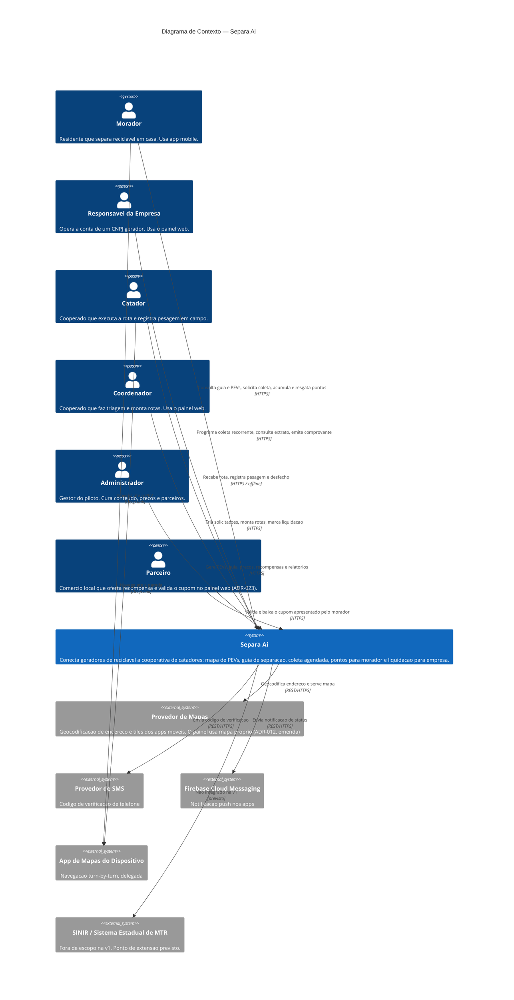
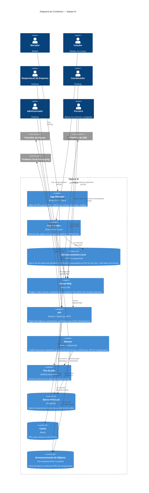

# C4 — Separa aí: Plataforma de Coleta Seletiva Municipal
**Versão:** 1.0 | **Data:** 12/09/2026 | **Níveis:** 1 (Contexto) e 2 (Containers)

> Nível 3 (Componentes) será produzido depois do ERD e do OpenAPI, quando as fronteiras de módulo estiverem estabilizadas.

---

## Nível 1 — Contexto do Sistema

### Leitura do contexto

O Separa aí é a camada de informação entre quem gera resíduo reciclável e quem o recolhe. Ele não substitui nenhum sistema existente, porque não existe sistema: hoje a coordenação acontece por telefone e combinação informal. Isso explica a ausência quase total de integrações de entrada no diagrama.

As seis personas se distribuem em três superfícies, e essa distribuição é decisão registrada, não consequência de desenho. Morador e Catador têm aplicativos móveis distintos por incompatibilidade de requisito de conectividade (ADR-001). Empresa, Coordenador e Administrador compartilham o painel web, porque todos os três executam trabalho de mesa, com listagem densa e emissão de documento (ADR-007). O Parceiro também entra pelo painel, numa superfície mínima que só valida cupom (ADR-023).

As integrações externas são todas de saída e todas substituíveis. Nenhuma delas guarda estado do domínio. A única com potencial de bloquear operação é o provedor de SMS, por estar no caminho do cadastro, e está tratada como risco na seção 8 do PRD.

O SINIR aparece no diagrama apesar de estar fora de escopo. A presença é intencional: o comprovante da RF-054 é registro operacional sem validade perante órgão ambiental, e desenhar a ausência dessa integração é mais honesto do que omiti-la, porque ela é a diferença entre o comprovante atual e um CDF.

---

## Nível 2 — Containers

### Containers

| Container | Tecnologia | Responsabilidade | Notas |
|---|---|---|---|
| App Morador | React Native / Expo | M1, M2, solicitação da RF-030, M4 | Android e iOS. Leve por decisão: o motor de sincronização não vive aqui |
| App Catador | React Native / Expo | RF-033, execução de rota | Android prioritário. Distribuição por canal fechado. Atualização OTA |
| Armazenamento Local | SQLite no dispositivo | Rota publicada e `operacoes_pendentes` | Só no app do catador. Dado pessoal expurgado ao término da rota; fila, 7 dias após a sincronização (ADR-015) |
| Painel Web | React SPA | Triagem, rotas, M5, curadoria, relatórios | Três perfis. Empresa é externa e só enxerga o próprio recorte (ADR-007). Servido pela API, no mesmo domínio e na mesma versão (emenda de 2026-09-28 do ADR-017). O fundo do mapa é um recorte do OpenStreetMap servido pela API, sem provedor externo (emenda de 2026-09-28 do ADR-012) |
| API | Node.js / TypeScript, Fastify, REST | Regras de negócio, autenticação, autorização, idempotência | TypeScript escolhido por continuidade com o ADR-002. Ver decisão pendente abaixo |
| Worker | Node.js / TypeScript | Crédito de pontos, liquidação, recorrências, notificações, PDF | Mesmo código-base da API, processo separado |
| Fila de Jobs | BullMQ sobre Redis | Eventos assíncronos e agendamento | Reaproveita o Redis do cache. Broker dedicado não se justifica nos volumes da seção 4.4 do PRD |
| Banco Principal | PostgreSQL 16 com PostGIS | Tudo que é transacional | Contêiner na VPS do piloto (ADR-019). Réplica de contingência entra no gatilho registrado no ADR-017 |
| Cache | Redis | PEVs, guia, sessão, rate limiting | Perda de cache é degradação, não indisponibilidade |
| Armazenamento de Objetos | S3-compatível | Fotos e PDFs | Nenhum dado estruturado aqui. No piloto, Floci em contêiner na VM, em modo persistente e sem porta publicada; Amazon S3 depois da migração (ADR-022, ADR-020). Nenhum objeto é servido por URL do armazenamento: a API o lê e o entrega a quem tem escopo |

### Fluxos de dados sensíveis

| Fluxo | Dado | Tratamento |
|---|---|---|
| API → App Catador | Endereço residencial de terceiros | Apenas as paradas das rotas publicadas do dia do próprio catador, cada uma só até a conclusão. Expurgo local ao término de cada rota (ADR-015) |
| App Catador → API | Peso, desfecho, foto de ausência | Lastreia crédito de pontos e liquidação. Idempotente por UUID de origem. EXIF removido no recebimento; foto retida por no máximo 90 dias (ADR-015) |
| API → Painel (perfil Empresa) | Extrato, estimativa e comprovante | Filtro de escopo aplicado na camada de consulta, nunca na interface. A empresa vê a estimativa calculada, não a tabela de preços (010) |
| API → Provedor de Mapas | Endereço textual | Endereço sai da plataforma na geocodificação. Avaliar provedor com cláusula de não retenção |
| API → Provedor de SMS | Celular | Único dado pessoal enviado a terceiro no cadastro |

### Pontos únicos de falha

| SPOF | Efeito | Mitigação |
|---|---|---|
| PostgreSQL | Indisponibilidade total de escrita | A partir do gatilho do ADR-017 (feature 005 em produção), réplica de contingência, RTO 4h e RPO 1h conforme seção 4.2 do PRD. Os apps degradam para modo local |
| API | Nenhuma operação nova | App do morador mantém guia, mapa e histórico. App do catador continua operando integralmente e enfileira |
| Redis | Cache e fila indisponíveis | Cache degrada para consulta ao banco. Fila parada atrasa pontos e notificações, sem perder evento, porque o job é reenfileirado a partir do estado no banco |
| Provedor de SMS | Cadastro novo bloqueado | Usuário já cadastrado não é afetado. Avaliar segundo provedor em contingência |
| Aparelho único do catador | Rota do dia inacessível | Risco operacional, não técnico. Coordenador pode reatribuir a rota a outro catador |

O ponto de atenção real não aparece como caixa no diagrama: o `SQLite` do app do catador guarda, por período, o único registro existente de uma pesagem feita em campo. Entre o registro e a sincronização, aquele dado não existe em nenhum outro lugar. É por isso que o ADR-003 trata a fila como estrutura de primeira classe e não como detalhe de implementação.

---

## Decisões que este diagrama antecipou, agora registradas

Os dois itens que apareciam aqui como pendência foram decididos e têm ADR próprio:

1. **Node.js e TypeScript no backend** — ADR-010.
2. **BullMQ sobre Redis em vez de broker dedicado** — ADR-011, com a invariante de que nenhum job pode ser a única fonte de um dado.

Os demais containers e integrações do diagrama estão cobertos por ADR-001, ADR-002, ADR-003, ADR-007, ADR-012 e ADR-013.

---

## Checklist de Qualidade

- [x] Todos os sistemas externos identificados, incluindo o não integrado (SINIR), declarado como tal
- [x] Protocolos indicados em todas as relações
- [x] Tecnologias especificadas em cada container
- [x] Fluxos de dados sensíveis destacados em seção própria
- [x] Pontos de falha únicos identificados, incluindo o não óbvio (SQLite do catador)
- [x] Consistência de nomenclatura com PRD e ADRs verificada
- [ ] Nível 3 pendente, previsto para depois do ERD e do OpenAPI
